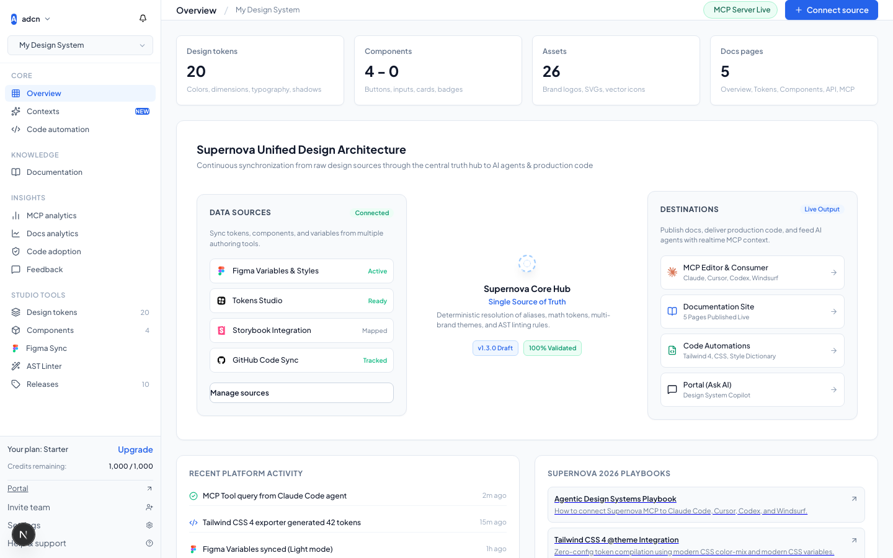
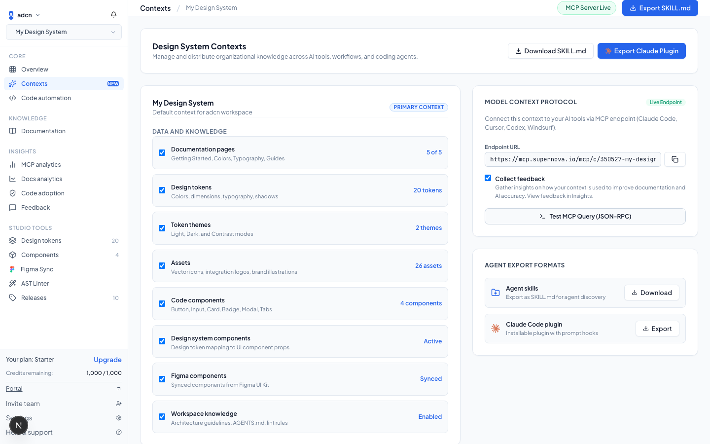
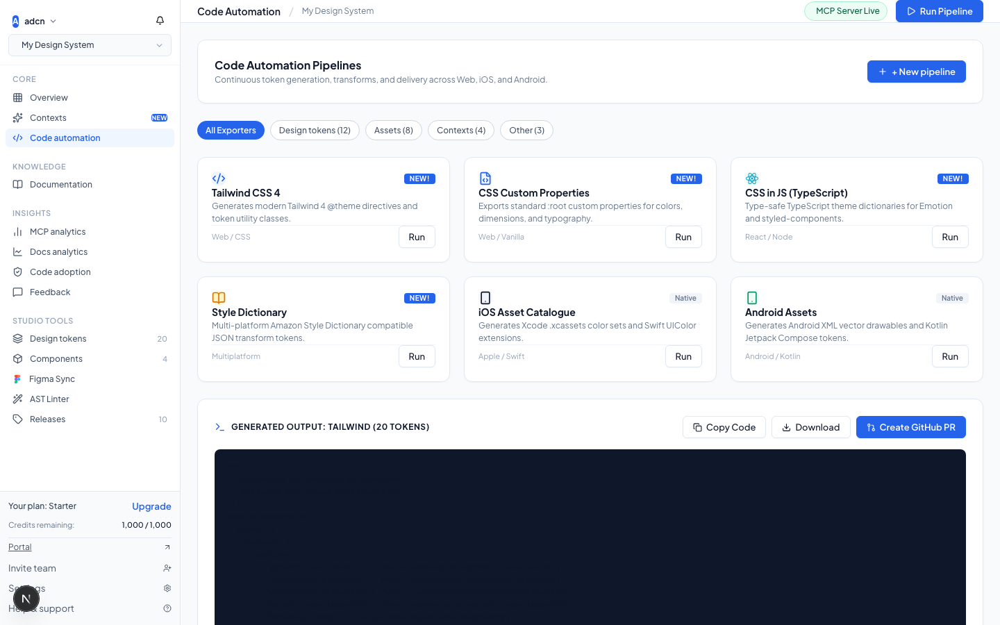
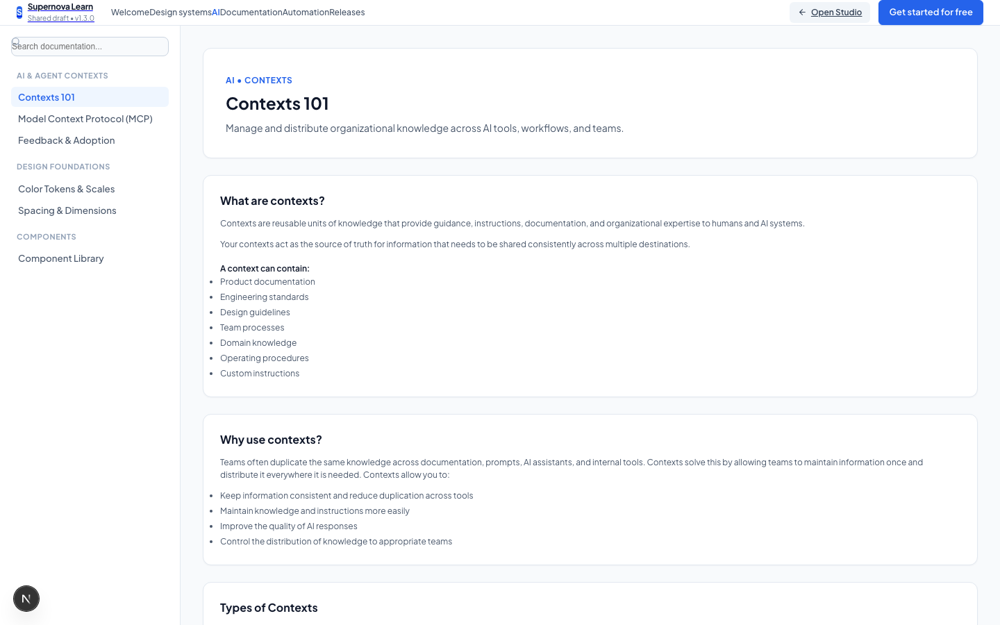
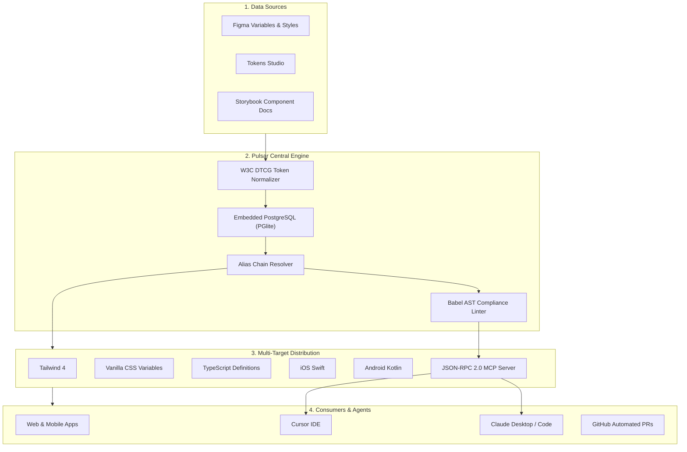

<div align="center">

# 🪐 PULSAR DESIGN OS

### The Enterprise Open-Source Design System Operating System & AI Context Engine

[](https://nextjs.org)
[](https://www.typescriptlang.org)
[](https://modelcontextprotocol.io)
[](https://vitest.dev)
[](https://opensource.org/licenses/MIT)

<p align="center">
  <b>Pulsar Design OS</b> is a unified, enterprise-grade design system engine connecting Figma variables to code tokens, generating multi-platform code (Tailwind, CSS, TS, iOS Swift, Android Kotlin), enforcing AST code compliance, and serving live design context to AI Coding Agents (Cursor, Claude, Copilot) via the <b>Model Context Protocol (MCP)</b>.
</p>

[Explore Features](#-features) • [Screenshots](#-visual-walkthrough) • [Quick Start](#-quick-start) • [MCP Server](#-model-context-protocol-mcp-integration) • [Architecture](#-architecture) • [CLI Reference](#-cli-reference)

</div>

---

## 📸 Visual Walkthrough

### 1. Central Design System Hub & Live Graph Architecture
Visual node graph connecting data sources (Figma, Tokens Studio, Storybook) through Pulsar's central token normalization engine to destinations (React, Tailwind, iOS Swift, Android Kotlin, Cursor, Claude).



---

### 2. AI Contexts Engine & MCP Endpoint Runner
Distribute design system context directly to AI coding agents. Includes interactive JSON-RPC 2.0 ping tester, Data & Knowledge checklist, and agent skill configurations.



---

### 3. Multi-Platform Code Automation & Continuous Delivery
Taxonomy-filtered exporter pipelines generating deterministic production code with one-click automated GitHub branch creation, commit staging, and Pull Request delivery.



---

### 4. Living Documentation Portal & Interactive Sandbox
Pure white enterprise documentation portal with official Contexts 101 guide, live token palette, interactive React component preview sandbox, and IDE integration instructions.



---

## ✨ Features

- 🎨 **Figma Variable & Token Synchronization:** Universal W3C Design Tokens Community Group (DTCG) specification engine supporting deep alias resolution chains (e.g., `{color.primitive.blue.500}` $\to$ `#3b82f6`) with automated cycle detection.
- 🤖 **Native Model Context Protocol (MCP) Server:** High-performance JSON-RPC 2.0 server exposing 8 production tools (`get_tokens`, `get_token`, `check_compliance`, `generate_code`, `list_components`, `import_figma_variables`, `propose_token_changes`, `get_design_system`).
- 📱 **Multi-Platform Code Exporters:** Deterministic, type-safe generation for:
  - **Tailwind CSS v4** (`tailwind.tokens.js`)
  - **CSS Custom Properties** (`tokens.css` with `:root` variables)
  - **TypeScript & React** (`tokens.ts` with strongly typed const maps)
  - **Style Dictionary JSON** (`tokens.json` DTCG tree)
  - **iOS SwiftUI** (`Tokens.swift` with `Color(hex:)` extensions)
  - **Android Jetpack Compose** (`Tokens.kt` with `Color(0xFF...)` values)
- 🔍 **Babel AST Quality Intelligence Linter:** Evaluates JSX/TSX Abstract Syntax Trees to flag hardcoded hex codes, un-tokenized spacing, and deprecated tokens—automatically suggesting replacement token variables.
- 🚀 **Continuous Delivery GitHub Pipeline:** Automatically generates Git branches (`pulsar/sync-*`), stages diff summaries, commits token updates, and opens GitHub Pull Requests.
- ⚡ **Zero-Dependency Embedded Database:** Powered by embedded WASM PostgreSQL (`PGlite`) with Drizzle ORM—runs locally or in containers without requiring an external database cluster.

---

## 🏗️ Architecture



---

## 🚀 Quick Start

### 1. Prerequisites
- **Node.js**: v18.0.0 or higher
- **npm** or **pnpm**

### 2. Installation
```bash
git clone https://github.com/prudhviraj0310/pulsar-design-os.git
cd pulsar-design-os
npm install
```

### 3. Seed Database
Seeds a full enterprise workspace, design system with 21 tokens, and React components:
```bash
npm run cli seed
```

### 4. Run Development Server
```bash
npm run dev
```
Open [http://localhost:3000](http://localhost:3000) for the **Pulsar Studio Platform** or [http://localhost:3000/docs](http://localhost:3000/docs) for the **Living Docs Portal**.

### 5. Run Automated Tests
```bash
npm test
```
Executes all 30 automated tests across token resolvers, exporters, AST linters, MCP servers, and delivery engines.

---

## 🤖 Model Context Protocol (MCP) Integration

Pulsar exposes an official MCP server over both **HTTP (`/api/mcp`)** and **Stdio (`npm run mcp`)**.

### Configure Cursor IDE
Add to your project's `.cursor/mcp.json`:
```json
{
  "mcpServers": {
    "pulsar-design-os": {
      "url": "http://localhost:3000/api/mcp"
    }
  }
}
```

### Configure Claude Desktop
Add to your `claude_desktop_config.json`:
```json
{
  "mcpServers": {
    "pulsar-design-os": {
      "command": "npx",
      "args": ["tsx", "/absolute/path/to/pulsar-design-os/src/mcp/server.ts"]
    }
  }
}
```

### Available MCP Tools

| Tool Name | Parameters | Description |
| :--- | :--- | :--- |
| `get_design_system` | `workspaceId`, `projectId` | Returns metadata, active version, and tenant status. |
| `get_tokens` | `workspaceId`, `projectId`, `category` | Returns all design tokens, optionally filtered by category (`color`, `spacing`, etc.). |
| `get_token` | `tokenPath` | Resolves alias chain and returns raw vs computed values. |
| `check_compliance` | `codeContent`, `filePath` | AST linting engine flagging un-tokenized colors or arbitrary dimensions. |
| `generate_code` | `format` (`css` \| `json` \| `typescript` \| `tailwind` \| `swift` \| `kotlin`) | Emits production code artifacts for the selected framework. |
| `list_components` | `category` | Lists UI components, TypeScript props, and token dependencies. |
| `import_figma_variables`| `fileKey`, `modeName`, `dryRun` | Ingests Figma variables and computes structural change diff. |
| `propose_token_changes` | `tokenPath`, `rawValue`, `category` | Proposes creating or updating a token in the central database. |

---

## 💻 CLI Reference

Pulsar includes a standalone CLI for CI/CD environments and developer workflows:

```bash
# Display CLI commands manual
npm run cli

# Seed database with sample tokens and components
npm run cli seed

# Export tokens to local files
npm run cli export ./dist/exported-tokens

# Audit a source file for design system compliance
npm run cli audit src/components/Card.tsx

# Run continuous delivery GitHub pull request pipeline
npm run cli deliver

# Start the MCP server over Stdio
npm run cli mcp
```

---

## 🌐 API Endpoints Reference

| Method | Endpoint | Description |
| :--- | :--- | :--- |
| `GET` | `/api/health` | Embedded database connectivity, active design system, and latency check |
| `GET` | `/api/tokens` | Full design tokens catalog with metadata |
| `POST`| `/api/tokens` | Insert or update tokens with automatic alias resolution |
| `GET` | `/api/components` | Component registry with React TypeScript prop signatures |
| `GET` | `/api/releases` | Version release changelog and historical tags |
| `GET` | `/api/export?format=<target>` | Generates code for `css`, `json`, `typescript`, `tailwind`, `swift`, or `kotlin` |
| `POST`| `/api/audit` | Analyzes code snippets using Babel AST and returns violation report |
| `POST`| `/api/figma/sync` | Calculates diff against incoming Figma variables |
| `POST`| `/api/deliver` | Creates Git branch and opens Pull Request |
| `POST`| `/api/mcp` | Standard JSON-RPC 2.0 Model Context Protocol endpoint |

---

## 🧪 Quality & Verification

Every component of Pulsar Design OS is rigorously validated:
- **Unit & Integration Tests:** 30 / 30 tests pass via Vitest (`npm test`).
- **Production Build:** Turbopack compiles in under 1 second with 0 TypeScript errors (`npm run build:next`).
- **Standards Compliant:** W3C Design Tokens Community Group (DTCG) syntax compliant.

---

## 📄 License

Distributed under the **MIT License**. See `LICENSE` for details.
